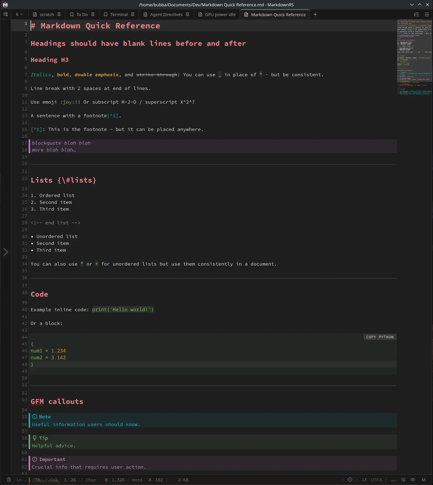
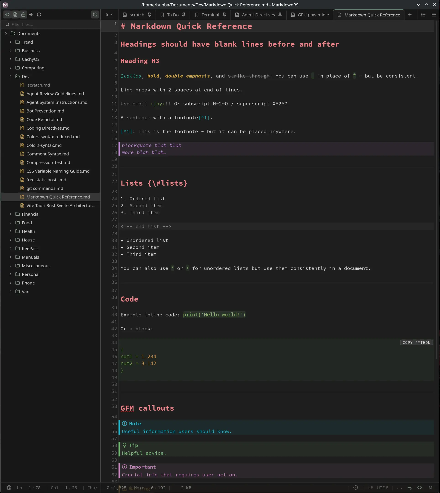
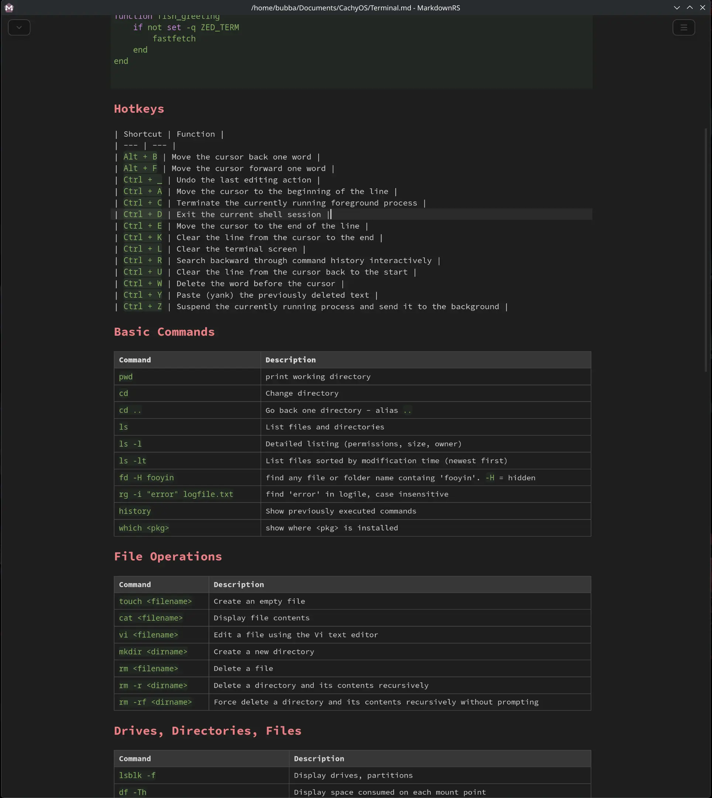
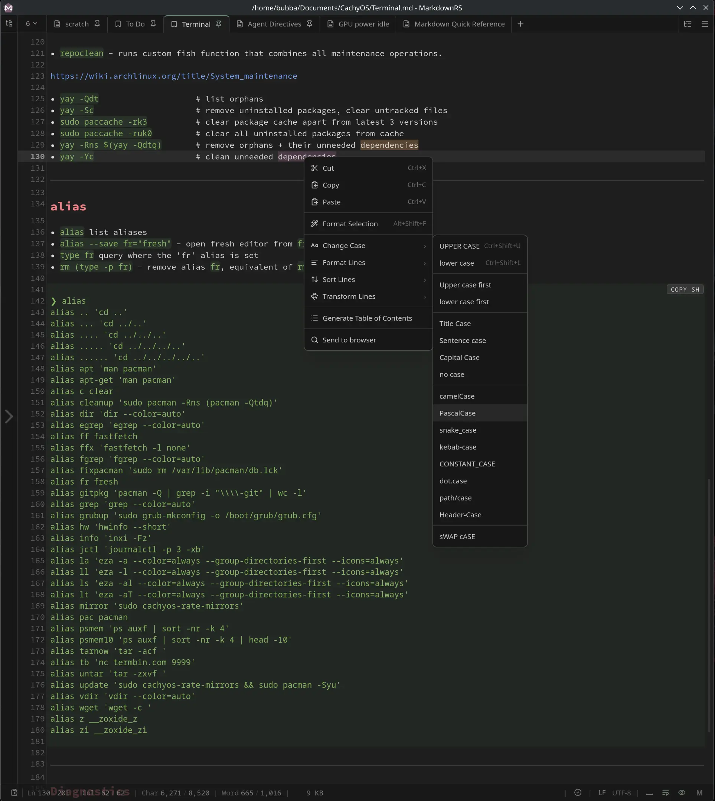
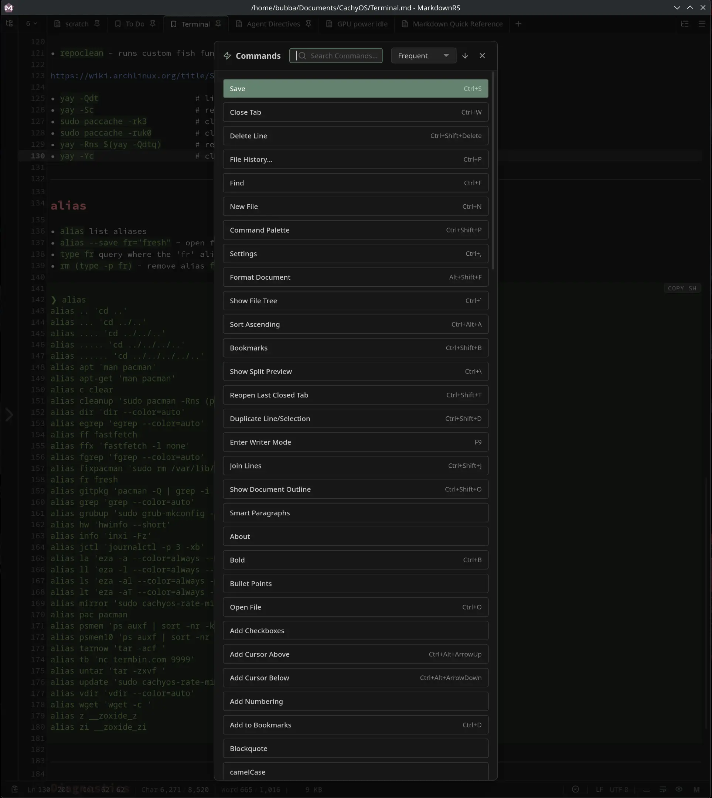
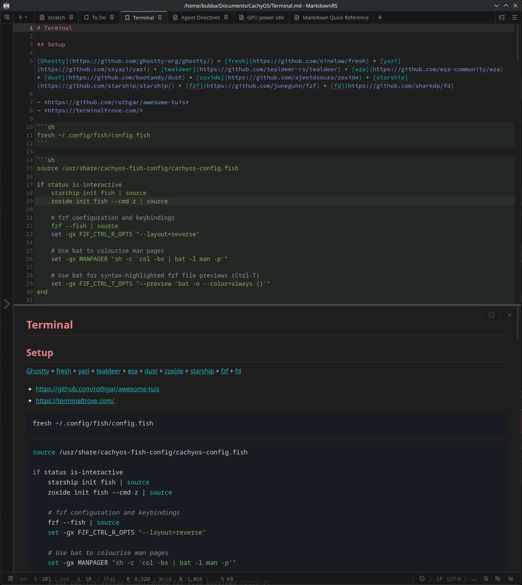
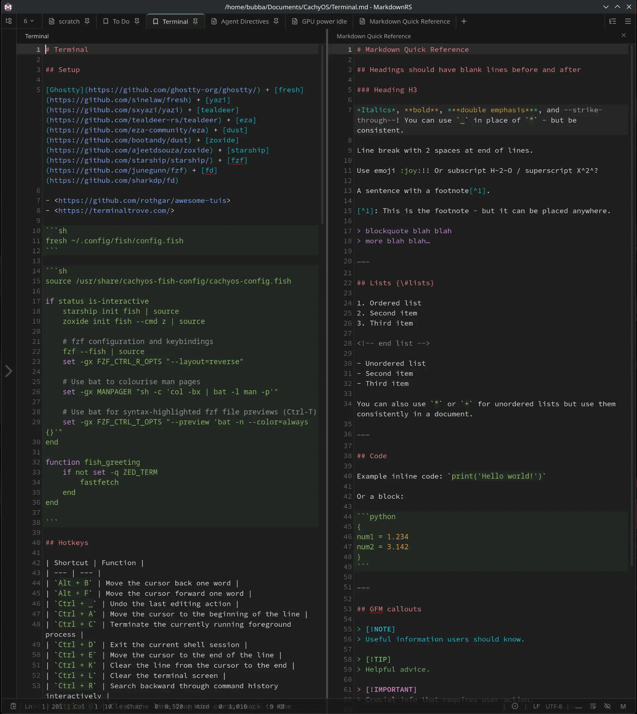
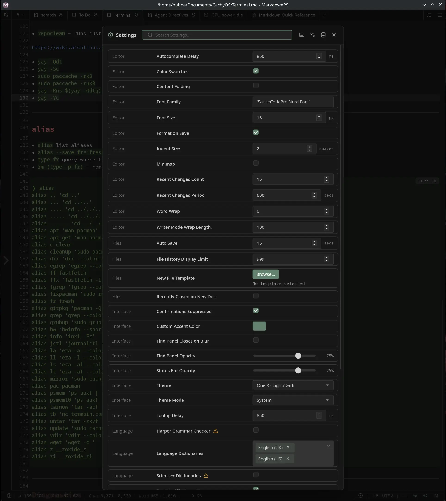
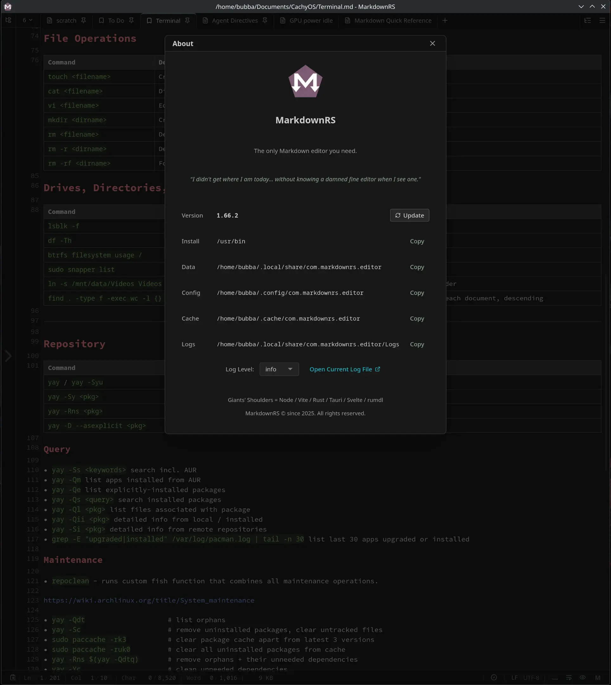

# MarkdownRS

 A feature-rich Markdown editor, focused on performance and minimal UI.

[](LICENSE) [](https://github.com/dcog989/MarkdownRS/issues) [](https://github.com/dcog989/MarkdownRS/stargazers)

        

## Features

### Performance

- **Native core:** Rust, Tauri and SQLite.
- **Startup:** in milliseconds, tuned for minimal resource usage.
- **Cached math:** KaTeX expressions are cached, never re-rendered.

### Editing

- **Markdown:** GitHub Flavored Markdown and CommonMark, raw or rendered mode.
- **Editor:** CodeMirror 6 with syntax highlighting, multi-cursor, bracket matching, whitespace display.
- **Find and replace:** across all open tabs, with match case, whole word and regex.
- **Lint and format:** embedded rumdl, rules edited in-app ([usage](#usage)).
- **Grammar:** optional Harper check, per-rule overrides in `settings.toml` ([usage](#usage)).
- **Text tools:** sort lines, case transforms, move or duplicate a line, comment toggle, frontmatter insertion.
- **Emoji:** picker.

### Preview

- **Split view:** bi-directional synchronised scrolling.
- **Math:** KaTeX inline and display, rendered offline.
- **Diagrams:** Mermaid fences, rendered offline.
- **Outline:** heading list that jumps to the section.
- **Writer mode:** the editor alone, no chrome.
- **Minimap:** scroll overview of the document.

### Documents

- **Tabs:** multi-tab editing with pinning and drag reordering; switch by number, by MRU, or reopen the last closed.
- **File tree:** live directory tree backed by a filesystem watcher.
- **Bookmarks:** tagged, stored in SQLite.
- **File history:** recently opened files.
- **Templates:** new files from per-type templates.
- **Hot exit:** unsaved buffers, scroll position and open tabs survive a close or crash.

### Export

- **Documents:** PDF, DOCX, EPUB, LaTeX.
- **Images:** PNG, WebP, SVG.
- **Web:** standalone HTML.

### Customisation

- **Themes:** built-in and custom, light, dark, or follow the OS.
- **Command palette:** every command searchable.
- **Shortcuts:** fully customisable, with reference sheet.
- **Zoom:** in, out and reset.
- **Spellcheck:** 44 downloadable dictionaries.
- **Toggles:** word wrap, minimap, whitespace and line-length guide.
- **Settings:** persisted in `settings.toml`.

### System Integration

- **Auto-update:** signed updates from GitHub Releases.
- **Packages:** AppImage, `.deb`, `.rpm`, pacman, Windows NSIS.

---

## Install

Download [GitHub Latest Release](https://github.com/dcog989/MarkdownRS/releases/latest):

| Platform        | Format                   | Install                                                     |
| --------------- | ------------------------ | ----------------------------------------------------------- |
| Linux           | AppImage                 | `chmod +x MarkdownRS_*.AppImage && ./MarkdownRS_*.AppImage` |
| Debian / Ubuntu | `.deb`                   | `sudo apt install ./MarkdownRS_*.deb`                       |
| Fedora / RHEL   | `.rpm`                   | `sudo dnf install ./MarkdownRS-*.rpm`                       |
| Arch / CachyOS  | `.pkg.tar.zst`           | `sudo pacman -U MarkdownRS-*.pkg.tar.zst`                   |
| Arch / CachyOS  | `PKGBUILD` (local build) | `bun install && bun run package`                            |
| Windows         | NSIS `.exe`              | run the `.exe`                                              |

> [!NOTE]
> The AppImage does not install anything, so copy the file to a permanent directory. The first run adds itself to the application menu, and makes itself the default Markdown handler.

---

## Usage

### Lint & Format

The embedded [rumdl](https://github.com/rvben/rumdl/) lints and formats Markdown; rules can be configured with the built-in editor. Config files (`.rumdl.toml` or `rumdl.toml`) can sit at project or home level; without one, the built-in defaults apply.

### Grammar

[Harper](https://writewithharper.com/) grammar checker rules can be edited in `settings.toml`:

```toml
[harperLinters]
OxfordComma = false      # disable a rule
LongSentences = true     # force a rule on
```

### Math

Math renders using standard [KaTeX](https://katex.org/) notation.

---

## Development

### Tech Stack

| Layer    | Stack                                                                                             |
| -------- | ------------------------------------------------------------------------------------------------- |
| Core     | [Rust](https://www.rust-lang.org/), [Tauri](https://v2.tauri.app/), [SQLite](https://sqlite.org/) |
| UI       | [Svelte](https://svelte.dev/), [TypeScript](https://www.typescriptlang.org/)                      |
| Editor   | [CodeMirror](https://codemirror.net/)                                                             |
| Build    | [Vite](https://vite.dev/), [bun](https://bun.com/), [Node.js](https://nodejs.org/)                |
| Quality  | [Vitest](https://vitest.dev/), [Biome](https://biomejs.dev/)                                      |
| Workflow | [Lefthook](https://github.com/evilmartians/lefthook), [Cocogitto](https://docs.cocogitto.io/)     |

### Build & Run

```sh
bun install            # Install dependencies
bun run check          # Full check: Svelte types, Biome lint, and cargo clippy
bun run fix            # Apply all fixes, then run the full check
bun run update         # Update packages + crates
bun run dev            # Start dev server / HMR
bunx tauri build       # Build distributable bundles (.deb, .rpm, .AppImage, NSIS)
bun run clean          # Remove build artifacts, target, and node_modules
sudo bun run package   # build, pack, then install (rerun `bun run pkg-install` if the password prompt is missed)
#
bun run website        # Start website dev server (HMR) @ http://localhost:5173/
```

### LLM Use

Large Language Models were used to assist with code generation and documentation. All output was subject to human review, automated testing, manual testing, and adversarial reviews.

---

## License

[GNU General Public License v3.0](LICENSE).
